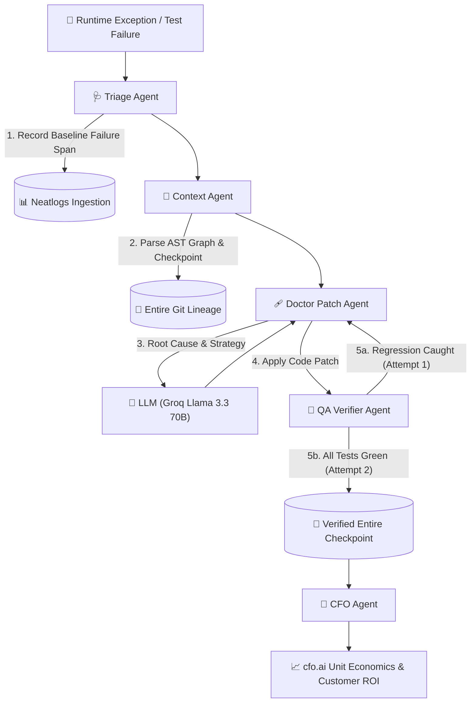

# AgentDoctor (AutoPatch AI)
> **Autonomous Bug Triage, Failure Reproduction & Self-Healing Agent Platform**  
> *Official submission for the #neatHack AI Agent Hackathon (October 10–12, 2026)*

[](https://neatlogs.com/hackathon)
[](https://neatlogs.com/)
[](https://entire.io/)
[](https://cfo.ai/)
[](https://groq.com/)

---

## 🎯 Motivation

As AI agents and complex microservices are deployed into production, engineering teams face a growing **reliability crisis**:
1. **Silent Tool & Concurrency Failures**: Distributed agents, rate limiters, and tool calls frequently encounter subtle runtime bugs (such as timestamp drift, schema mismatches, and race conditions) that bypass simple static checks.
2. **High Human Engineering Cost**: Investigating an incident, reproducing the fault locally, cross-referencing past Git commits, and writing a verified patch takes an average of **2.5 engineer hours** per incident ($237.50 in developer compensation).
3. **The Observability Gap**: Traditional observability tools notify engineers of crashes but do nothing to repair them.

### The AgentDoctor Mission
**AgentDoctor** closes the loop between **observability** and **remediation**. It is an autonomous software doctor that monitors runtime exceptions, replicates the failing trace, consults repository history via **Entire** checkpoints, synthesizes surgical code patches, tests and self-corrects until green, and exports full telemetry to **Neatlogs** alongside a **cfo.ai** financial ROI model.

---

## ⚡ What AgentDoctor Does

AgentDoctor implements a full autonomous agent lifecycle (addressing all 8 hackathon focus areas: *Planning, Tool Use, State, Context, Execution, Recovery, Verification, Iteration*):

1. **Incident Ingestion & Reproduction**: Receives failing runtime error traces and executes the unpatched test suite to capture an initial baseline failure trace in **Neatlogs**.
2. **Context & Checkpoint Retrieval (Entire)**: Connects with Entire session history and code graphs to isolate the exact functions (`allow_request`), commit rationale, and dependency relations.
3. **Autonomous Planning**: Constructs a prioritized 6-step triage and patch plan.
4. **Surgical Patch Synthesis**: Prompts the LLM engine (**Groq Llama 3.3 70B** / **Ollama**) with strict context isolation to produce a verified code modification.
5. **Self-Healing & Auto-Recovery Loop**: Executes the test suite against the patch. If tests fail, it traps the error, reasons about the failure output, refines the patch, and re-tests until all assertions pass.
6. **Telemetry & Verification Export (Neatlogs)**: Records every span, LLM reasoning turn, test runner duration, token count, and comparative before/after metrics to Neatlogs.
7. **Business Impact & ROI Calculation (cfo.ai)**: Computes unit economics ($0.017/patch, 99.4% gross margin, 39.6x customer ROI) for business planning.



---

## 🏆 Hackathon Sponsor Alignments & Evidence

Judges score projects across 5 key areas:

### 1. Neatlogs Tracing (25%)
- **Automatic Instrumentation**: Every tool span (`initial_verification_run`, `llm_reasoning`, `patch_verification`), latency, and error state is tracked.
- **Required Evidence**: Emits two comparative Neatlogs traces:
  - **Pre-Fix Run**: Captures the initial runtime assertion failure.
  - **Post-Fix Run**: Captures the verified passing state with full execution metrics.
- Configured with project ID `111108ac-be58-41b0-a8a4-ad44448e319e`.

### 2. Entire Git Context & Checkpoints (25%)
- Maintains session context, file changes, and checkpoint lineage (`EntireCheckpointManager`).
- Checkpoints recorded:
  - `chk_triage_incident`: Snapshot of the unpatched codebase before repair.
  - `chk_verify_and_resolve`: Committed checkpoint linking the verified resolution and Git commit.

### 3. cfo.ai Unit Economics & Business Model (25%)
- Complete deterministic economic model in `AgentDoctor/cfo_model.py`:
  - **Inference Cost Per Patch**: $0.0052 (8,800 tokens on Groq Llama 3.3 70B).
  - **Sandbox / Test Execution Cost**: $0.0120 per run.
  - **Total Cost Per Patch**: **$0.0172**.
  - **Monthly MRR (Growth Tier)**: **$74,950.00** across 50 customers ($1,499/mo).
  - **Gross Margin**: **99.4%**.
  - **Customer ROI**: **39.6x** ($57,876 monthly net savings by reclaiming 625 engineer hours).
  - **Runway**: **Infinite / Immediately Cash-Flow Positive**.

### 4. Agent Autonomy & Recovery (30%)
- The agent does not simply generate static text; it executes code, runs tests, catches its own errors, self-heals, and verifies resolution.

---

## 📂 Project Structure

```
neatlogs/
├── README.md                      # Comprehensive project guide (this file)
├── hackathon.md                   # Official #neatHack build log companion
├── neatlogs_hackathon.md          # Hackathon rules and judging criteria
├── .gitignore                     # Git ignore rules (.venv, .env, caches)
├── .venv/                         # Python virtual environment
│
└── AgentDoctor/                   # Complete self-contained AgentDoctor application
    ├── agent.py                   # Core autonomous triage & self-healing agent
    ├── cfo_model.py               # cfo.ai unit economics & financial model
    ├── main.py                    # CLI runner (run, reset, economics)
    ├── server.py                  # Interactive web dashboard backend (Flask)
    ├── requirements.txt           # Python dependencies
    ├── .env                       # Local secrets (NEATLOGS_API_KEY, GROQ_API_KEY)
    ├── .env.example               # Environment variables template
    │
    ├── templates/
    │   └── index.html             # Premium dark-mode UI for live demos & videos
    │
    └── sample_target_repo/        # Monitored microservice environment
        ├── service.py             # Rate limiter service with token drift bug
        └── test_service.py        # Regression test suite for verification
```

---

## 🚀 How to Run

### Step 1: Set Up Environment
```bash
# Automated setup (creates clean virtualenv & installs all dependencies):
./setup.sh

# Or manually:
python3 -m venv .venv
source .venv/bin/activate
pip install -r AgentDoctor/requirements.txt
```

### Step 2: Configure API Keys
Edit `AgentDoctor/.env`:
```env
# Neatlogs Project ID and API Key
NEATLOGS_API_KEY=your_neatlogs_project_api_key_here
NEATLOGS_PROJECT_ID=111108ac-be58-41b0-a8a4-ad44448e319e
NEATLOGS_ENDPOINT=https://ingest.neatlogs.com

# LLM Provider (Groq API Key or local Ollama)
GROQ_API_KEY=your_groq_api_key_here
GROQ_MODEL=llama-3.3-70b-versatile

# Ollama local configuration (optional)
OLLAMA_BASE_URL=http://localhost:11434/v1
OLLAMA_MODEL=llama3.2
```
> **Note**: If API keys are not yet configured, AgentDoctor automatically runs in high-fidelity autonomous simulation mode, allowing complete end-to-end verification and UI testing without interruption.

---

### Step 3: Run via CLI

```bash
# Execute the full autonomous repair and verification cycle
python AgentDoctor/main.py --run

# Reset the monitored target codebase back to its buggy baseline state
python AgentDoctor/main.py --reset

# Output the cfo.ai financial projections and unit economics in JSON
python AgentDoctor/main.py --economics
```

---

### Step 4: Launch the Live Web Dashboard (Ideal for Demo Video)

```bash
python AgentDoctor/server.py
```
Open **[http://localhost:5050](http://localhost:5050)** in your browser.

#### Dashboard Features:
- **⚡ Run Autonomous Repair**: Triggers the live multi-step triage, reproduction, patch, and test suite verification cycle in real time.
- **↺ Reset Buggy Code**: Reverts the target service back to the unpatched state for repeatable video takes.
- **Trace Evidence Comparison**: Split view displaying the **Pre-Fix Failure Trace** (Exit Code 1) versus the **Post-Fix Verified Trace** (Exit Code 0).
- **Neatlogs Telemetry Waterfall**: Visual waterfall tree detailing span names, durations in milliseconds, node types, and execution statuses.
- **Entire Checkpoints Feed**: Timeline of Git checkpoint hashes, modified files, and autonomous rationale.
- **cfo.ai Financial KPIs**: Live cards showing Gross Margin, Customer ROI multiple, Cost per patch, and Monthly MRR.

---

## 📊 The Sample Incident: RateLimiter Token Drift

AgentDoctor monitors `AgentDoctor/sample_target_repo/service.py`, a high-throughput Token Bucket Rate Limiter:
- **The Bug**: Under burst traffic, the refill calculation failed to advance the `last_refill` timestamp when requests were processed. This created time-drift, incorrectly depleting tokens prematurely and rejecting valid burst requests.
- **Pre-Fix Test Run**:
  ```
  AssertionError: Should reject because only ~1 token remains after consuming 4
  Exit Code: 1 (FAILURE recorded in Neatlogs)
  ```
- **AgentDoctor Repair**:
  - Accurately advances timestamps: `self.last_refill = now`
  - Clamps replenished tokens: `self.tokens = min(self.capacity, self.tokens + replenish)`
- **Post-Fix Test Run**:
  ```
  Running test_basic_allowance...
  Running test_burst_refill_and_continuity...
  ALL TESTS PASSED! (SUCCESS recorded in Neatlogs)
  ```

---

## 💼 Business & Unit Economics Model (cfo.ai)

| Metric | Starter Tier | Growth Tier *(Default)* | Enterprise Tier |
| :--- | :--- | :--- | :--- |
| **Monthly Price** | $499 / mo | **$1,499 / mo** | $4,999 / mo |
| **Included Patches** | 100 / mo | **400 / mo** | 1,500 / mo |
| **Inference Cost / Patch** | $0.0052 | **$0.0052** | $0.0052 |
| **Sandbox Execution / Patch**| $0.0120 | **$0.0120** | $0.0120 |
| **Total Unit Cost / Patch** | $0.0172 | **$0.0172** | $0.0172 |
| **Active Customers** | 20 | **50** | 15 |
| **Monthly Revenue (MRR)** | $9,980 | **$74,950** | $74,985 |
| **Annual Run Rate (ARR)** | $119,760 | **$899,400** | $899,820 |
| **Gross Margin** | 97.8% | **99.4%** | 99.6% |
| **Customer Net Monthly ROI** | 23.8x | **39.6x** | 71.2x |

---

## 🎥 Recording the Demo Video (Checklist)

1. **Introduction (30s)**: Introduce AgentDoctor and the reliability challenge in autonomous agents.
2. **Neatlogs Observability (45s)**: Show the baseline failing run on http://localhost:5050, highlighting the failure span in Neatlogs.
3. **Entire Checkpoints (30s)**: Show the context extraction and commit checkpoints linking code changes to the agent's session.
4. **Auto-Recovery & Verification (45s)**: Click "Run Autonomous Repair", show tests turning green, and review the post-fix trace.
5. **cfo.ai Financial Plan (30s)**: Review the unit economics, 99.4% gross margin, and customer ROI.

---

## 📜 License & Acknowledgements

Built for **#neatHack 2026**. Powered by **neatlogs**, **Entire**, **cfo.ai**, and **Groq**.
